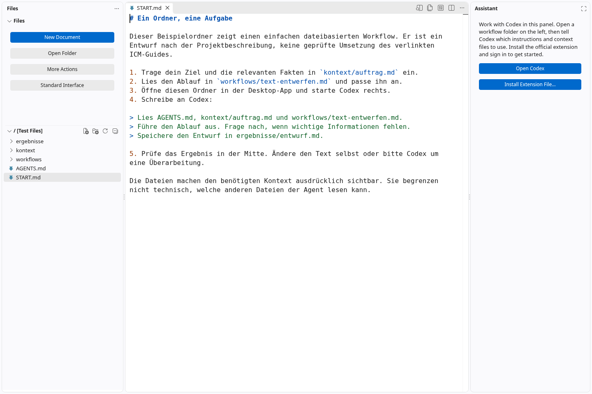

# Simple Workspace · Dateien, Texte und Codex

Ein experimenteller Fork von **Code – OSS** für Menschen ohne Programmierhintergrund:
Dateien links, das Dokument in der Mitte und die offizielle Codex-Extension rechts.
Ziel ist eine ruhige Arbeitsumgebung für wiederverwendbare Abläufe mit überschaubarem
Kontext in Ordnern und Markdown-Dateien.



## Was dieser erste Stand kann

- **Simple Workspace** öffnet sich bei neuen Profilen automatisch. Über **Standard Interface** links, oben oder im Zahnradmenü wechselst du zurück; **Simple Workspace** bringt dich wieder in die einfache Ansicht.
- Dateiverwaltung mit gut sichtbaren Aktionen und erklärenden Tooltips.
- Texte und Markdown direkt bearbeiten; Live Preview und visuellen Markdown-Editor aufrufen.
- Die Activity Bar links bleibt sichtbar: Explorer, Suche, Quellcodeverwaltung, Erweiterungen und Ansichten installierter Erweiterungen sind direkt erreichbar. Statusleiste, Minimap, Zeilennummern und automatische Code-Vorschläge werden ausgeblendet. Das untere Panel wird geschlossen; Outline und Timeline werden ausgeblendet.
- Eine installierte offizielle Codex-Extension (`openai.chatgpt`) in das rechte Panel verschieben.
  Ohne Extension erscheint eine Einführung mit Katalogsuche und Installation aus einer VSIX-Datei.
- Beim Ausschalten die vorherige Anordnung wiederherstellen. Persönliche Editor-Einstellungen
  werden dabei nicht überschrieben.

Entwicklungsfunktionen bleiben technisch vorhanden und über Befehle erreichbar.
Die erste Version ist ein Oberflächenprototyp; es gibt noch keinen fertigen Installer.

Der [Plan für die Smartphone-Oberfläche](docs/simple-workspace/mobile-ui-plan.md)
beschreibt eine responsive Ansicht mit umschaltbaren Screens und eine spätere optionale PWA.
Das ist ein Entwurf; die mobile Oberfläche ist noch nicht implementiert.

## Am einfachsten testen: im Browser

Voraussetzungen: Git, **Node.js 24** (mindestens die Version in `.nvmrc`), npm,
ein aktueller Chrome/Chromium oder Edge und einige GB freier Speicher.

```sh
git clone --depth 1 --branch main https://github.com/marmor69/vscode.git simple-workspace
cd simple-workspace
node scripts/simple-workspace.mts --setup
node scripts/simple-workspace.mts --web
```

1. Öffne **http://localhost:8080**.
2. Die einfache Ansicht erscheint automatisch. Öffne `START.md` links. Der mitgelieferte Beispielordner erklärt einen kleinen Workflow.
3. Bearbeite einen Text; öffne **More Actions → Live Preview** für die Markdown-Vorschau.
4. Über das Erweiterungssymbol links kannst du den Open-VSX-Katalog durchsuchen.
5. **Standard Interface** links oder im Zahnradmenü stellt die volle Oberfläche wieder her.

Das Setup installiert festgeschriebene JavaScript-Abhängigkeiten und baut die Web-Oberfläche
samt den für diese Demo benötigten Erweiterungen. Es installiert weder Electron noch native Module.
Es kann beim ersten Mal mehrere Minuten dauern. Nach reinen Änderungen an der Oberfläche reicht
`npm run build-fast -- --client-only`, danach die Browserseite neu laden.

**Die Browser-Demo dient zum Oberflächentest.** Der eingehängte Beispielordner wird im Speicher
bearbeitet; Änderungen werden nicht in die lokalen Beispieldateien zurückgeschrieben und können
beim Neuladen verloren gehen. Die Desktop-Codex-Extension läuft nicht in dieser reinen Web-Demo.
Für echte Arbeit und dauerhaft gespeicherte Dateien verwende den Docker-Server
oder den Desktop-Build.

## Im Browser mit Agent: Docker und Dokploy

Für echte Arbeitsordner, Terminalprozesse und Agenten auf einem VPS verwende den
vollständigen Serverbetrieb mit [Dockerfile](Dockerfile) und [compose.yml](compose.yml).
Die [Dokploy-Anleitung](deploy/docker/README.md) beschreibt Git-Quelle, HTTPS-Domain,
Zugangstoken und dauerhafte Volumes. Der Server und die Extensions werden beim
Image-Build kompiliert; Neustarts behalten Dateien, Einstellungen und Agentenanmeldung.
In der vereinfachten Ansicht ist „Run and Debug“ in der Activity Bar ausgeblendet.
Codex wird bei aktivierter automatischer Installation auf die konfigurierte stabile
Version (`ICM_CODEX_VERSION`) abgeglichen, auch bei bestehenden Installationen.
Claude Code wird ebenfalls standardmäßig installiert (`ICM_INSTALL_CLAUDE=true`,
`ICM_CLAUDE_VERSION=latest`). **Choose Assistant** bietet Codex, Claude Code und
GitHub Copilot an. Der integrierte Copilot-Chat erscheint in der vereinfachten Ansicht
erst nach ausdrücklicher Auswahl. Die Office-Erweiterung
`cweijan.vscode-office` wird standardmäßig installiert; ihre Telemetrie ist standardmäßig deaktiviert.

Dieser Weg verwendet den Code–OSS-Server mit einem Extension-Prozess im Container.
Die JavaScript-Web-Demo oben dient weiterhin dem schnellen Oberflächentest.

Hinter Cloudflare Access kann der Docker-Server mit `ICM_AUTH_MODE=proxy` ohne
zusätzlichen URL-Token betrieben werden. Standardmäßig wird die externe ICM-Vorlage
als **Beispiel-Projekt** angelegt (`ICM_INIT_EXAMPLE=false` schaltet dies ab).
Details stehen in der [Dokploy-Anleitung](deploy/docker/README.md).

## Desktop mit Codex testen

Verwende einen eigenen Checkout für den Desktop und folge zunächst den
[plattformabhängigen Build-Voraussetzungen von VS Code](https://github.com/microsoft/vscode/wiki/How-to-Contribute#prerequisites).
Dazu gehören je nach System native Build-Werkzeuge und Bibliotheken.

```sh
npm ci
npm run compile
./scripts/code.sh --user-data-dir .build/simple-workspace-user --extensions-dir .build/simple-workspace-extensions
```

Unter Windows lautet der letzte Aufruf `scripts\code.bat` mit denselben Argumenten.
Der erste Start lädt zusätzlich Electron und eingebaute Erweiterungen.
Verwende für diesen Weg **nicht** die Installation mit `--ignore-scripts` aus dem Web-Setup.

1. Die einfache Ansicht ist beim ersten Start aktiv. Über **Standard Interface** im Zahnradmenü oder links kannst du jederzeit zur normalen Oberfläche wechseln.
2. Öffne **Extensions** in der Activity Bar links und suche nach **Codex**. Prüfe den Herausgeber **OpenAI** und die Kennung `openai.chatgpt`, bevor du installierst.
3. **Open Codex → Codex** öffnet die installierte Extension rechts. Melde dich dort an.
4. Kopiere `examples/icm-starter` in deinen eigenen Arbeitsordner, öffne ihn über **Open Folder** und folge `START.md`.

Der Fork nutzt [Open VSX](https://open-vsx.org/) als Erweiterungskatalog. Das ist **nicht** der Microsoft Visual Studio Marketplace; manche dort gelisteten Erweiterungen fehlen auf Open VSX. Die offizielle Codex-Erweiterung ist auf Open VSX unter `openai.chatgpt` gelistet. Falls eine Erweiterung dort fehlt, installiere eine vom Herausgeber bereitgestellte `.vsix` über **Install Extension File…**. Siehe auch die [Codex IDE-Dokumentation](https://developers.openai.com/codex/ide/). Die Extension wird nicht mitgeliefert. Anmeldung und tatsächliche Codex-Ausführung im Desktop-Fork müssen noch auf den Zielsystemen überprüft werden.

## Beschriftungen anpassen

Die neue Oberfläche verwendet zentral verwaltete, lokalisierbare Texte.
Eigene Beschriftungen können jederzeit in den Benutzereinstellungen (`settings.json`) geändert werden:

```json
{
  "workbench.simpleUI.enabled": true,
  "workbench.simpleUI.agent": "openai.chatgpt",
  "workbench.simpleUI.labels": {
    "files": "Meine Dateien",
    "assistant": "Mein Assistent",
    "newDocument": "Neuer Text",
    "openFolder": "Ordner öffnen",
    "more": "Weitere Aktionen",
    "preview": "Live-Vorschau",
    "chooseAgent": "Codex öffnen",
    "installExtension": "Extension-Datei installieren…",
    "standardUI": "Vollständige Oberfläche"
  }
}
```

Die vollständigen Schlüssel und Tooltips stehen in
[`simpleUILabels.ts`](src/vs/workbench/contrib/simpleUI/browser/simpleUILabels.ts).
Diese Anpassung betrifft die neuen Bedienelemente; Texte innerhalb von Codex oder anderen
Extensions werden von deren Herausgebern verwaltet. Neue Texte sind zunächst auf Englisch;
die obigen Überschreibungen ermöglichen bereits eigene deutsche Bezeichnungen.

## ICM und Architektur

Der [Beispielordner](examples/icm-starter/START.md) trennt Auftrag/Kontext, Workflow und Ergebnis.
Das ist zunächst eine praktische Vorlage nach der Projektbeschreibung. Der genaue Abgleich mit dem
[bereitgestellten ICM-Guide](https://gist.github.com/LvlyBot/91c386584c99e4f3c300013d5cebaf78)
steht noch aus, weil der Zugriff in der Cloud-Umgebung blockiert war.
Die Ordnerstruktur ist eine Arbeitskonvention, keine technische Einschränkung des Agentenkontexts.

Die Änderungen liegen überwiegend in einer eigenen
[Workbench-Contribution](src/vs/workbench/contrib/simpleUI/README.md).
Dazu kommen ein Import, ein kleiner Explorer-Titel-Hook, die Registrierung für Übersetzungen und die Open-VSX-Konfiguration in `product.json`. Der Web-Teststarter übernimmt diese Konfiguration in die lokale, ignorierte `product.overrides.json`.
Editor, Dateiverwaltung, Markdown-Erweiterung und Extension-Host bleiben Upstream-Komponenten.
Das hält den Fork klein und erleichtert die Übernahme neuer Upstream-Stände.

## Geprüfter Stand

- Browser-Setup vollständig ausgeführt; Client-Build, TypeScript-Prüfung und gezieltes ESLint bestanden.
- Vier Regressionstests zur Wiederherstellung der Einstellungen bestanden.
- Automatischen Start, sichtbare Activity Bar, Dateibaum, Markdown-Textansicht, Neuladen und Umschalten im Chromium-Browser geprüft.
- Open-VSX-Katalog und die Suche nach der Codex-Erweiterung von OpenAI im Browser geprüft.
- Tooltips, neue Markdown-Dokumente und Texteingabe geprüft; beim Moduswechsel bleibt der Text erhalten.
- Die Markdown-Vorschau wird geöffnet, ihr Inhalt konnte in der Cloud nicht geprüft werden:
  Der dortige Browser verweigert die Service-Worker-Registrierung der eingebauten Webview.
  Vorschau und visuellen Editor deshalb zusätzlich in einem lokalen Browser bzw. Desktop-Build prüfen.
- Codex-Anmeldeoberfläche im Docker-Webserver mit korrigierter Webview-CDN-Version in Chromium geladen.
- Offizielle Codex-Kontoanmeldung und Agentenausführung im Desktop-Fork noch nicht getestet.

## Herkunft und Lizenz

Dies ist ein unabhängiger experimenteller Fork von
[Microsofts Code – OSS](https://github.com/microsoft/vscode), keine offizielle VS-Code- oder OpenAI-Distribution.
Der Quellcode steht unter der [MIT-Lizenz](LICENSE.txt); bestehende Copyright- und
[Drittanbieterhinweise](ThirdPartyNotices.txt) bleiben erhalten.
Die [Upstream-Dokumentation](https://github.com/microsoft/vscode/blob/main/README.md)
beschreibt das ursprüngliche Projekt.
